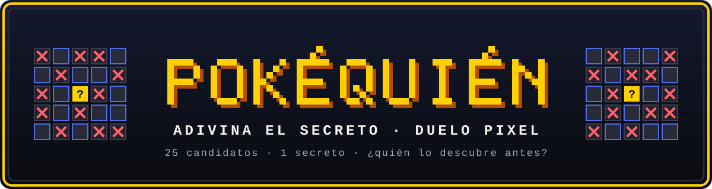
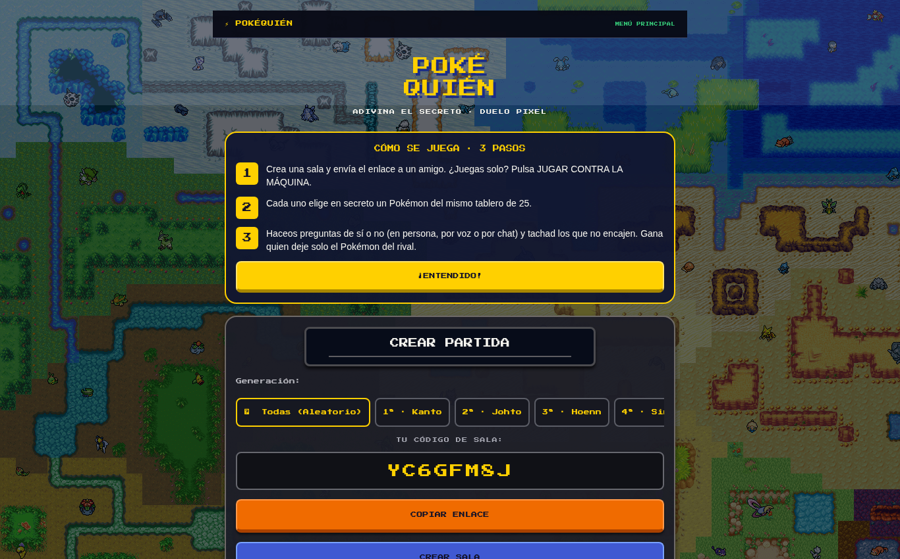
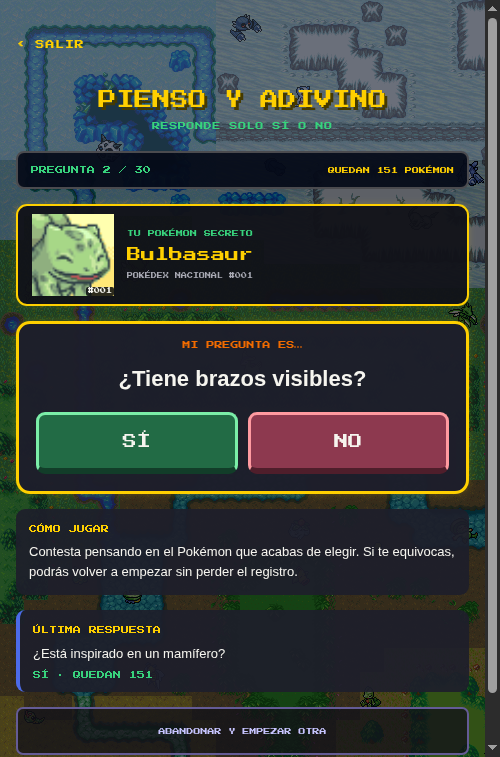
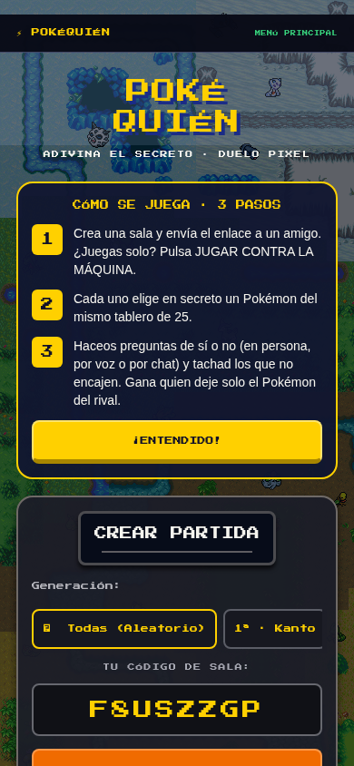

<p align="center">
  <a href="https://bertmarti.github.io/Adivina-pkm/"></a>
</p>

<p align="center">
  <a href="https://bertmarti.github.io/Adivina-pkm/"></a>
  
  
  
  
  <a href="LICENSE"></a>
</p>

<p align="center"><b>Un duelo de deducción pixel-art inspirado en «¿Quién es Quién?»<br>pero con Pokémon. Descubre el secreto de tu rival… ¡antes de que él descubra el tuyo!</b></p>

<h2 align="center">
  🎮 <a href="https://bertmarti.github.io/Adivina-pkm/">Jugar ahora en el navegador →</a>
</h2>

<p align="center"><sub>Sin instalar nada y sin cuenta. Funciona en el ordenador y en el móvil, y el Solitario también sin conexión.</sub></p>

---

## 📸 Capturas de pantalla

<p align="center">
  
</p>
<p align="center"><sub>🏠 Inicio: la primera vez te explica cómo se juega en 3 pasos; luego crea una sala o únete con el código de tu rival.</sub></p>

<p align="center">
  
</p>
<p align="center"><sub>🤖 Solitario: piensa en un Pokémon y responde Sí o No; la máquina intenta adivinarlo.</sub></p>

<p align="center">
  
</p>
<p align="center"><sub>📱 Pensado primero para el móvil.</sub></p>

---

## 📖 Tabla de contenido

- [📸 Capturas de pantalla](#-capturas-de-pantalla)
- [🌍 ¿Qué es PokéQuién?](#-qué-es-pokéquién)
- [🚀 Tu primera partida en 3 pasos](#-tu-primera-partida-en-3-pasos)
- [🕹️ Modo Duelo (2 jugadores)](#️-modo-duelo-2-jugadores)
- [🤖 Modo Solitario (1 jugador)](#-modo-solitario-1-jugador)
- [🗺️ Generaciones disponibles](#️-generaciones-disponibles)
- [🎨 Interfaz y estética](#-interfaz-y-estética)
- [🔊 Sonidos y sensaciones](#-sonidos-y-sensaciones)
- [📱 Compatibilidad](#-compatibilidad)
- [❓ Preguntas frecuentes](#-preguntas-frecuentes)
- [🌟 Créditos](#-créditos)
- [🛠️ Lo que tienes que hacer tú (quien administra el servidor)](#️-lo-que-tienes-que-hacer-tú-quien-administra-el-servidor)
- [🖥️ ¿Quieres tu propio servidor de duelos?](#️-quieres-tu-propio-servidor-de-duelos)

---

## 🌍 ¿Qué es PokéQuién?


**PokéQuién** es un juego de deducción donde cada jugador elige un Pokémon en secreto y, mediante preguntas y descartes, intenta averiguar cuál escogió el rival.

La partida se juega sobre un tablero de **25 Pokémon** distribuidos en una cuadrícula **5×5**, con retratos pixel-art al estilo **Pokémon Mystery Dungeon**, fondo con scanlines CRT y tipografía arcade.

> 🎯 **Objetivo:** Deja un solo Pokémon en tu tablero y que sea el secreto de tu rival. ¡Gana el más rápido!

---

## 🚀 Tu primera partida en 3 pasos

1. **Crea una sala y envía el enlace** a tu rival, o pulsa **JUGAR CONTRA LA MÁQUINA** para jugar en Solitario.
2. En el Duelo, cada jugador **elige en secreto un Pokémon** del mismo tablero de 25.
3. Haceos **preguntas de sí o no** en persona, por voz o por chat y tachad los descartes. Gana quien deje solo el Pokémon del rival.

> 💡 El modo **Solitario** no necesita el servidor de salas. El **Duelo** necesita internet porque los dos jugadores se conectan a una sala compartida.

---

## 🕹️ Modo Duelo (2 jugadores)


El modo principal de PokéQuién. Dos entrenadores se enfrentan en tiempo real.

### 📌 Paso 1 · Crear la sala

```
┌──────────────────────────────────────┐
│  🏠 PANTALLA DE INICIO               │
│                                      │
│  ◉ Elige generación: Kanto / Todas…  │
│                                      │
│  Código: A1B2C3D4                    │
│  [ 📋 COPIAR ENLACE ]               │
│  [ ⚡ CREAR SALA ]                   │
│                                      │
│  ─── o conectar con código ───       │
│  [ CÓDIGO RIVAL ] [ 🔗 CONECTAR ]   │
└──────────────────────────────────────┘
```

1. Selecciona la **generación** con la que quieres jugar
2. Pulsa **CREAR SALA** — se genera un código de 8 caracteres
3. **Comparte el enlace** (o el código) con tu rival
4. Tu rival abre el enlace y entra directamente a la sala

>  **Tip:** También puedes pegar un código que te hayan enviado y pulsar **CONECTAR**.

---

### 📌 Paso 2 · Elegir tu Pokémon secreto


Cuando ambos jugadores están dentro, aparece la cuadrícula **5×5** con 25 Pokémon idénticos para los dos.

```
┌────┬────┬────┬────┬────┐
│ 🌱 │ 🔥 │ 💧 │ ⚡ │ 🌙 │
├────┼────┼────┼────┼────┤
│ 🐉 │ 🐾 │ 🦋 │ 🌊 │ 🌿 │
├────┼────┼────┼────┼────┤
│ ⭐ │ 👻 │ 🧊 │ 🪨 │ 🪽 │
├────┼────┼────┼────┼────┤
│ 🐸 │ 🐯 │ 🐢 │ 🦊 │ 🐙 │
├────┼────┼────┼────┼────┤
│ 🐭 │ 🐲 │ 🐝 │ 🌸 │ ❄️ │
└────┴────┴────┴────┴────┘
```

- **Toca una casilla** para elegir tu secreto — ¡la elección es instantánea e irreversible!
- Si tu rival aún no eligió, verás tu Pokémon y una **Poké Ball animada** de espera.
- Mientras esperas al rival o eliges, tienes el botón **‹ SALIR DE LA SALA**.
- Nadie puede ver el secreto del otro.

---

### 📌 Paso 3 · ¡El duelo!

```
        ┌──────────┐          ┌──────────┐
        │  TÚ  ⚔️  │    VS    │  RIVAL 🔮│
        │ [sprite] │          │   [ ? ]  │
        ├──────────┤          ├──────────┤
        │ Tu tablero│         │Su tablero│
        │  25 mons  │         │ 25 mons  │
        └──────────┘          └──────────┘
```

Solo puedes actuar sobre **tu propio tablero**:

| Acción | Descripción |
|:------:|:-----------|
| 👆 **Tachar** | Pulsa un Pokémon → aparece una **X roja** y su retrato cambia a expresión triste 😢 |
| 🔄 **Destachar** | Pulsa otra vez el mismo Pokémon → se recupera con expresión feliz 😊 |
| 👀 **Consultar** | Mira el tablero rival para ver qué ha descartado (¡pero no puedes tocar!) |

>  El número Dex y el nombre aparecen en cada casilla para ayudarte a identificar a cada Pokémon.

---

### 📌 Paso 4 · ¡Victoria!

```
  24 tachados  ✕✕✕✕✕✕✕✕✕✕✕✕✕✕✕✕✕✕✕✕✕✕✕✕
                    +
  1 candidato libre  =  ⭐ ¡¡VICTORIA!! ⭐
```

Cuando quede **un único Pokémon** en tu tablero y ese Pokémon **sea el secreto de tu rival**, ¡ganas!

Al finalizar:
- 🏆 El ganador escucha una **fanfarria de victoria**
- 💀 El perdedor escucha un **tono de derrota**
- 📊 Se muestra tu Pokémon con su retrato, descripción y hasta **3 curiosidades**
- 🔁 Pulsa **JUGAR DE NUEVO** para otra ronda en la misma sala

---

### 🔌 Desconexiones


Si un jugador se desconecta (eligiendo, esperando o durante la partida):

- ⏳ La sala **espera 60 segundos** para que vuelva y verás el aviso «EL RIVAL SE HA DESCONECTADO · Le esperamos...».
- ✅ Si reconecta a tiempo → recupera su tablero y continúa.
- ❌ Si no vuelve → la partida se marca como **abandono** y se vuelve al menú.

---

## 🤖 Modo Solitario (1 jugador)


¡Pon a prueba a la máquina! Accede desde el botón **MODO SOLITARIO · JUGAR CONTRA LA MÁQUINA** en la pantalla principal.

### ¿Cómo funciona?

```
  1. TÚ eliges un Pokémon en secreto 🤫
                 │
                 ▼
  2. ❓ La máquina pregunta: "¿Es de tipo Agua?"
              [ SÍ ]    [ NO ]
                 │
                 ▼
  3. ❓ "¿Predomina el color azul?"
              [ SÍ ]    [ NO ]
                 │
                 ▼
  4. ❓ "¿Tiene manos?"  …y así hasta adivinar…
                 │
                 ▼
  5. 🎯 "¡Tu Pokémon es Squirtle!"
           [ ✅ SÍ ]    [ ❌ NO ]
```

### 📜 Reglas del Modo Solitario

| Regla | Detalle |
|:------|:--------|
| 🔐 **Secreto real** | La máquina **NUNCA** ve tu elección. Solo conoce tus respuestas SÍ/NO |
| ❓ **Máximo 30 preguntas** | Si la máquina no adivina en 30 preguntas, **¡tú ganas!** |
| 🧠 **Preguntas inteligentes** | Usa ganancia de información para elegir la pregunta que mejor divide los candidatos |
| 🔍 **Tipos de preguntas** | Tipos, colores, animal inspirador, forma del cuerpo, silueta, patas, manos, alas… |
| 🚫 **Sin trampas** | No pregunta por número de Pokédex ni por peso exacto |
| ↩️ **Rechazar propuesta** | Si la máquina propone un Pokémon incorrecto, dile NO y continuará buscando |

### 📊 Historial y exportación

- 📜 Cada partida se guarda automáticamente en tu historial local
- 📋 **COPIAR JSON** para exportar tus sesiones
- 🗑️ **BORRAR** para limpiar el historial cuando quieras

### 🎮 Catálogos disponibles

| Catálogo | Pokémon | Descripción |
|:---------|:-------:|:------------|
| 🔴 **Kanto** | 151 | Los clásicos de la primera generación |
| 🌐 **Nacional** | 1.025 | ¡Toda la Pokédex conocida! |

---

## 🗺️ Generaciones disponibles

<p align="center">
  
  
  
  
  
  
  
  
  
</p>

Elige con qué Pokémon jugar en el modo Duelo:

| Gen | Región | Rango Dex | Pokémon |
|:---:|:------:|:---------:|:-------:|
| 🌐 | **Todas** | #001 – #1025 | 1.025 |
| 1️⃣ | **Kanto** | #001 – #151 | 151 |
| 2️⃣ | **Johto** | #152 – #251 | 100 |
| 3️⃣ | **Hoenn** | #252 – #386 | 135 |
| 4️⃣ | **Sinnoh** | #387 – #493 | 107 |
| 5️⃣ | **Unova** | #494 – #649 | 156 |
| 6️⃣ | **Kalos** | #650 – #721 | 72 |
| 7️⃣ | **Alola** | #722 – #809 | 88 |
| 8️⃣ | **Galar** | #810 – #905 | 96 |
| 9️⃣ | **Paldea** | #906 – #1025 | 120 |

> De los Pokémon de la generación elegida, se seleccionan **25 al azar** para formar el tablero de cada partida.

---

## 🎨 Interfaz y estética


PokéQuién está diseñado con una estética **pixel-art retro** inspirada en Pokémon Mystery Dungeon:

- 🖥️ **Fondo CRT** con scanlines horizontales y mapa pixel-art
- 🔤 **Tipografía arcade propia**, PokeQuien Pixel (basada en Press Start 2P), con las mayúsculas acentuadas enteras: «SÍ», «CÓDIGO», «POKÉMON»
- 🟡 **Colores clásicos**: amarillos, azules, naranjas sobre fondo oscuro
- 🖼️ **Marcos gruesos** con sombras y botones con relieve
- 😊→😢 Los retratos cambian de expresión al tachar (Happy → Sad)
- ✨ Animaciones suaves que se reducen si el dispositivo pide menos movimiento
- 🦻 Con lector de pantalla, la app anuncia cada fase de la partida y qué tienes que hacer, y los botones pequeños tienen una zona táctil cómoda

---

## 🔊 Sonidos y sensaciones

| Acción | Feedback sonoro | Feedback háptico |
|:-------|:---------------|:-----------------|
| ◉ Elegir Pokémon | 🔊 Sonido de selección | 📳 Vibración suave |
| ✕ Tachar | 🔊 Confirmación corta | 📳 Vibración de aviso |
| ↺ Destachar | 🔊 Sonido de selección | 📳 Vibración suave |
| ⭐ Ganar | 🎵 Fanfarria de victoria | 📳 Vibración de éxito |
| ☁️ Perder | 🎵 Tono de derrota | 📳 Vibración de error |

> Los sonidos y vibraciones funcionan en móvil. En web se reproduce un tono sintetizado como respaldo.

---

## 📱 Compatibilidad

```
  📱 Móvil (Android / iOS)  ──────  💻 Web  ──────  📱 Tablet
          Cuadrícula 5×5 responsive · Retratos siempre visibles
```

La interfaz se adapta al tamaño de pantalla. Los retratos escalan automáticamente y el tablero mantiene un ancho máximo de 720 px para pantallas grandes.

---

## ❓ Preguntas frecuentes

<details>
<summary><b>¿Es gratis?</b></summary>
<br>
Sí. Es un proyecto de fans sin anuncios ni compras. La web está alojada en GitHub Pages y el servidor de salas en un plan gratuito.
</details>

<details>
<summary><b>¿Necesito crear una cuenta?</b></summary>
<br>
No. Para jugar un Duelo solo compartes un código de sala de 8 caracteres o el enlace que genera la app.
</details>

<details>
<summary><b>¿Funciona en el móvil?</b></summary>
<br>
Sí. La web se adapta a la pantalla del móvil y puedes instalarla como una app desde el navegador (mira «¿Puedo instalarla como una app?»). Toda la interfaz está pensada primero para pantallas pequeñas y dedos (botones grandes). La app nativa de Android no está en ninguna tienda: de momento solo se reparte en privado, por enlace.
</details>

<details>
<summary><b>¿Por qué tarda en conectar el Duelo?</b></summary>
<br>
El servidor gratuito «se duerme» cuando nadie juega. La primera conexión puede tardar hasta 1 minuto y verás el aviso «Despertando el servidor de duelos…». Mientras conecta, puedes pulsar <b>CANCELAR</b>. Si falla, pulsa <b>REINTENTAR</b>.
</details>

<details>
<summary><b>Me sale «No hemos podido contactar con el servidor de duelos»</b></summary>
<br>
Puede que esté despertando (el plan gratuito tarda hasta 1 minuto la primera vez), que esté en mantenimiento o que no tengas conexión. Espera unos segundos y pulsa <b>REINTENTAR</b>. Si sigue sin responder, puedes jugar al <b>Solitario</b>, que no necesita servidor.
</details>

<details>
<summary><b>¿Qué versión tengo?</b></summary>
<br>
Puedes ver la versión en el pie de la pantalla de inicio, en el apartado <b>ACERCA DE</b>. PokéQuién 1.0.0 es la versión estable actual.
</details>

<details>
<summary><b>Me sale «El servidor de duelos no admite partidas desde esta web»</b></summary>
<br>
El servidor está rechazando la web desde la que juegas. Tiene que arreglarlo quien lo administra; consulta el apartado de administración de abajo.
</details>

<details>
<summary><b>El código no funciona</b></summary>
<br>
Debe tener 8 caracteres. Las salas que genera la app usan letras y números del 2 al 9, sin <b>0</b>, <b>1</b>, <b>I</b> ni <b>O</b>. Las salas vacías caducan a los 30 minutos: pide a tu rival que genere otra o que te envíe el enlace de invitación.
</details>

<details>
<summary><b>¿Qué pasa si se corta la conexión?</b></summary>
<br>
Tienes 1 minuto para volver: la app intenta reconectarte sola a la misma sala. Si pasa ese tiempo, la partida termina por abandono.
</details>

<details>
<summary><b>¿Se guardan mis datos?</b></summary>
<br>
No hay cuentas ni datos personales. En un Duelo tu dispositivo guarda solo un código temporal para poder reconectarte. El historial del Solitario se queda en tu dispositivo y puedes borrarlo con el botón <b>BORRAR</b>.
</details>

<details>
<summary><b>¿Puedo instalarla como una app?</b></summary>
<br>
Sí. En el móvil, abre la web y elige <b>Añadir a pantalla de inicio</b> (o <b>Instalar app</b>) en el menú del navegador; en el ordenador, pulsa el icono de instalar de la barra de direcciones. Se abre a pantalla completa con su propio icono y no ocupa casi nada.
</details>

<details>
<summary><b>¿Puedo jugar sin internet?</b></summary>
<br>
Sí, al Solitario. La primera vez abre la web con conexión: el navegador guarda el juego y, a partir de ahí, PokéQuién se abre y se juega aunque no tengas red. Los retratos que ya hayas visto también se guardan; los que no, se verán vacíos hasta que vuelva la conexión, pero puedes jugar igual. El Duelo sí necesita internet.
</details>

<details>
<summary><b>¿Es un juego oficial de Pokémon?</b></summary>
<br>
No. Es un proyecto de fans no oficial y sin ánimo de lucro. Pokémon y sus nombres son marcas de Nintendo, Creatures Inc. y GAME FREAK inc.
</details>

---

## 🌟 Créditos

<p align="center">
  
</p>

Inspirado por **Checo_512** y su juego [Adivina Quién Pokémon](https://adivina-quien-pokemon.vercel.app/).

| Recurso | Fuente |
|:--------|:-------|
| 🖼️ Retratos y fondo | [SpriteCollab (PMD)](https://sprites.pmdcollab.org/) — CC BY-NC 4.0 (no comercial; autoría de cada retrato en la fuente) |
| 📊 Datos de Pokémon | [PokéAPI](https://pokeapi.co/) |
| 🔤 Tipografía | PokeQuien Pixel, derivada de [Press Start 2P](https://fonts.google.com/specimen/Press+Start+2P) — SIL OFL 1.1 |
| 🎞️ GIF de espera (Poké Ball, Pikachu) y 🔊 sonidos de selección/victoria/derrota | Material de fans/juegos Pokémon, propiedad de sus autores; uso sin ánimo de lucro y retirada si lo piden |

**Proyecto de fans no oficial y sin ánimo de lucro.** Pokémon © Nintendo, Creatures Inc. y GAME FREAK inc. Consulta el detalle de archivos y licencias en [CREDITOS.md](CREDITOS.md).

## 🛠️ Lo que tienes que hacer tú (quien administra el servidor)

Queda un ajuste en el servicio `pokequien-rooms` del panel de [Render](https://dashboard.render.com), para que deje de instalar la app entera (Expo) y solo instale el servidor:

1. En **Settings → Build & Deploy**, pon **Root Directory** en `server`, **Build Command** en `npm ci --omit=dev` y **Start Command** en `node room-server.js`. Si el servicio se creó desde el Blueprint, basta con **Blueprints → Sync**, porque `render.yaml` ya lo trae.
2. En **Environment**, comprueba `ROOM_SERVER_ALLOWED_ORIGINS` = `https://bertmarti.github.io` y `ROOM_SERVER_TRUST_PROXY` = `1` (a 24/10/2026 ya parecían puestas) y pulsa **Save Changes**.
3. Ve a **Manual Deploy → Deploy latest commit**. En los logs debe aparecer `✔ Servidor de salas 1.0.0 escuchando…`.
4. Abre `https://pokequien-rooms.onrender.com/`: debe devolver `"ok":true` y, con la 1.0.0 ya desplegada, `"version":"1.0.0"` (el 26/10/2026 respondía sin `version`: señal de que Render aún ejecutaba un servidor anterior). Comprueba también `curl -H "Origin: https://bertmarti.github.io" https://pokequien-rooms.onrender.com/`: debe devolver `"originAllowed":true` (el 26/10/2026 ya respondía así).
5. Haz una prueba real: abre <https://bertmarti.github.io/Adivina-pkm/>, pulsa **CREAR SALA**, usa **INVITAR (ENLACE)** y abre el enlace en otro dispositivo.

Si algo falla:

- **No hemos podido contactar con el servidor de duelos**: Render puede estar despertando o el servicio no responde. Espera y pulsa **REINTENTAR**.
- **El servidor de duelos no admite partidas desde esta web**: revisa `ROOM_SERVER_ALLOWED_ORIGINS` y vuelve a desplegar.
- **Código inexistente, sala llena o partida terminada**: comprueba el enlace y el estado de la sala; las salas vacías caducan a los 30 minutos.

## 🖥️ ¿Quieres tu propio servidor de duelos?

Necesitas **Node.js 22.13 o superior** (el servidor solo, sin la app, funciona desde Node 20.19):

```bash
git clone https://github.com/BertMarti/Adivina-pkm
cd Adivina-pkm
npm install
npm run server
```

Para instalar y arrancar solo el servidor: `cd server && npm ci && npm start`. Consulta la ayuda con `npm run server:help`. Para conectar la app en desarrollo, sigue [docs/DESARROLLO.md](docs/DESARROLLO.md); por ejemplo: `EXPO_PUBLIC_ROOM_SERVER_URL=ws://192.168.1.50:8787 npm run web`.

---

<p align="center">
  <sub>
    Fan project no oficial, creado con cariño para la comunidad Pokémon 💛<br>
    Pokémon y todos los nombres relacionados son marcas registradas de Nintendo / Game Freak / The Pokémon Company.
  </sub>
</p>

<p align="center">
  
  
  
  
  
</p>

---

<p align="center">🛠️ ¿Quieres programar o desplegar PokéQuién? Mira <a href="docs/DESARROLLO.md">docs/DESARROLLO.md</a>.</p>
